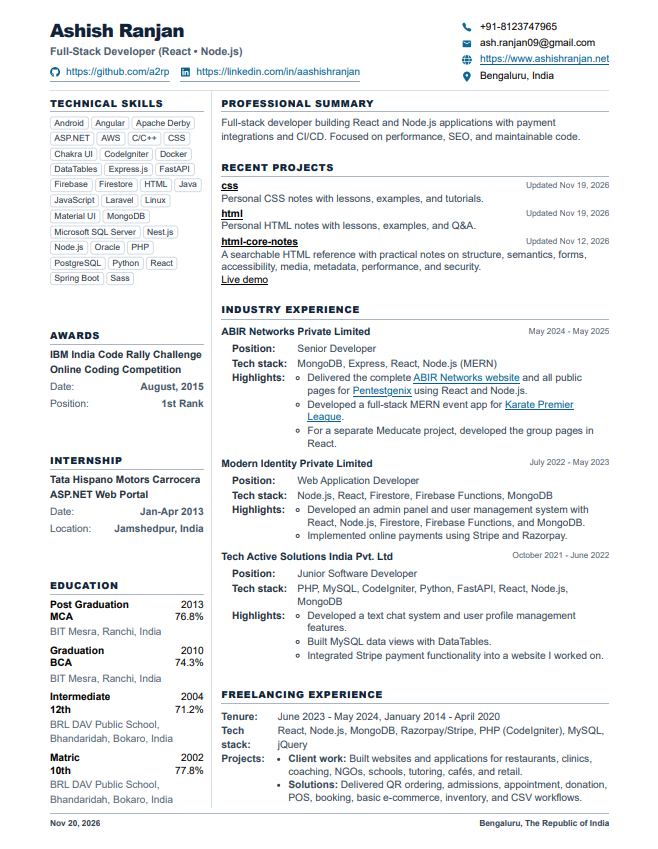

<div align="center">

<h1>Ashish Ranjan</h1>

<h3>Full-Stack Developer | React &amp; Node.js</h3>

<p>Responsive resume website with recent projects, a print-ready layout, and a downloadable PDF.</p>

<p>
  <a href="https://a2rp.github.io/resume/"></a>
  <a href="https://a2rp.github.io/resume/resume-only"></a>
  <a href="https://github.com/a2rp/resume/releases/latest/download/Ashish_Ranjan_Resume.pdf"></a>
</p>

<p>
  <a href="https://github.com/a2rp/resume/actions/workflows/deploy.yml"></a>
  
  
  
</p>

<br />



</div>

## Overview

This repository contains my public resume website and its print-focused resume view. Both pages render the same resume component, so experience, skills, education, and project details stay consistent. The full page adds the site header and footer; the standalone page leaves those out for reading or printing.

## Pages

| Page | URL | Purpose |
| --- | --- | --- |
| Public resume | [a2rp.github.io/resume](https://a2rp.github.io/resume/) | Resume with site header, PDF download, and footer. |
| Resume only | [a2rp.github.io/resume/resume-only](https://a2rp.github.io/resume/resume-only) | Resume content without site navigation. |
| Latest PDF | [GitHub release download](https://github.com/a2rp/resume/releases/latest/download/Ashish_Ranjan_Resume.pdf) | Downloadable PDF attached to the latest release. |

## What the site includes

- Resume sections for professional summary, technical skills, industry and freelance experience, education, awards, and internship experience.
- Responsive layouts for desktop, tablet, and mobile screens.
- A recent projects section populated from my public GitHub repositories.
- Portfolio, contact, and social links in the site navigation and footer.
- Print styles that hide site navigation and format the resume for printing.
- Lazy-loaded pages, a shared resume component, and a loading state while pages are imported.

### How recent projects are selected

The page requests my public repositories from the GitHub API, ordered by most recently pushed. It displays up to three repositories that have a description, skips forks and the `resume` and `a2rp` repositories, and shows a live demo link when a repository has an HTTPS homepage. If GitHub cannot be reached, the page provides a link to browse my repositories directly.

## Run locally

Requires Node.js 20 or newer and npm.

```bash
npm ci
npm run dev
```

Open the local URL printed by Vite. The resume-only route is available at `/resume-only`.

| Command | Purpose |
| --- | --- |
| `npm run lint` | Check the JavaScript and JSX with ESLint. |
| `npm run build` | Create the production site in `dist/`. |
| `npm run preview` | Serve the production build locally. Run the build first. |

## Update the resume PDF

The header's Download PDF buttons use the stable GitHub URL for the latest release. The button does not point at the local copy in `public/`, so publishing a replacement PDF does not require a code change.

1. Create a new release in this repository with a new tag.
2. Attach the PDF with the exact filename `Ashish_Ranjan_Resume.pdf`.
3. Mark the release as **Latest** and publish it.

The release asset name must stay the same because the download link uses it. The local copy tracked with the website is `public/pdf/Ashish_Ranjan_Resume.pdf`.

## Deploy to GitHub Pages

Every push to `main` starts [the GitHub Pages workflow](.github/workflows/deploy.yml). The workflow installs dependencies, builds the site, and publishes the contents of `dist/`. Vite uses `/resume/` as the site base and creates a `404.html` fallback so client-side routes work when opened directly.

## Project structure

```text
.
|-- README.md               Project guide
|-- screenshot.png          README preview image
|-- src/
|   |-- App.jsx             App entry component
|   |-- main.jsx            React and BrowserRouter setup
|   |-- appRoutes/          Lazy-loaded route definitions
|   |-- components/         Header, footer, loader, and back-to-top control
|   |-- layouts/siteLayout/ Shared header/content/footer layout
|   |-- pages/              Public home and resume-only pages
|   \-- resume/             Shared resume content and print styles
\-- public/
    \-- pdf/                Local resume PDF copy
```

## Technology

React · React Router · Vite · CSS Modules · React Icons · GitHub Pages
